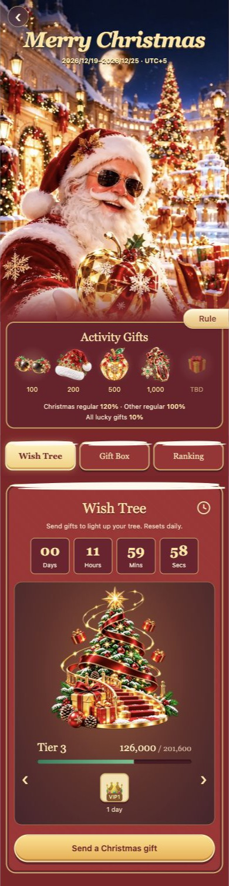
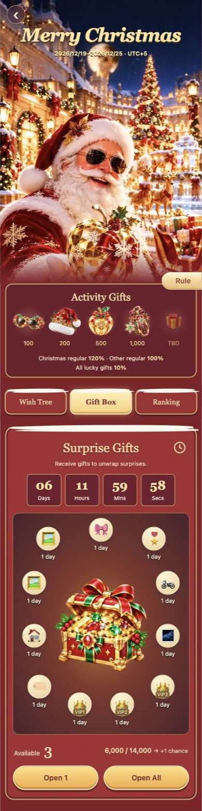
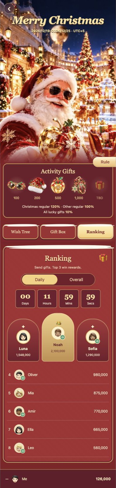
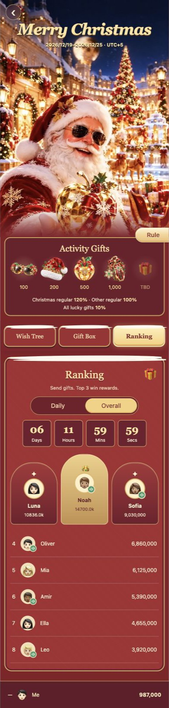
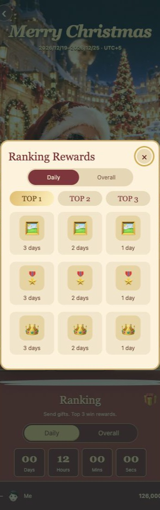
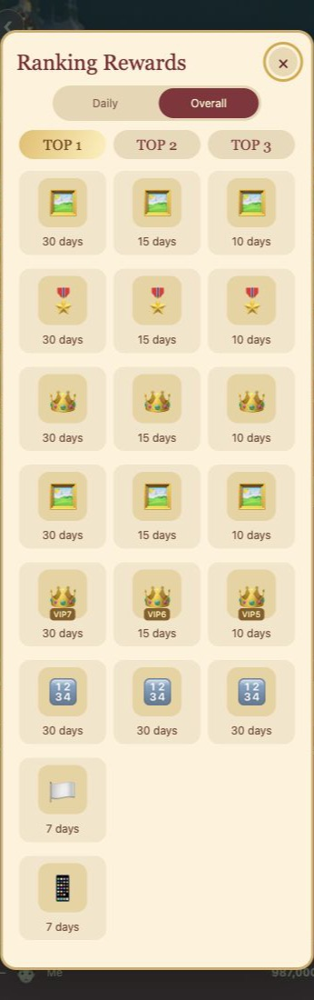
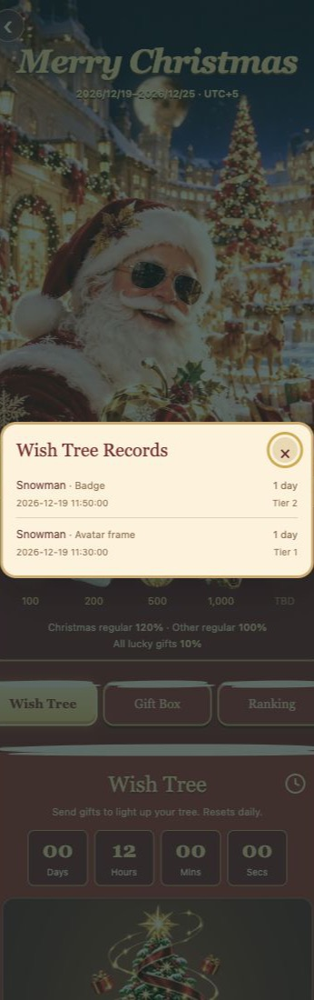
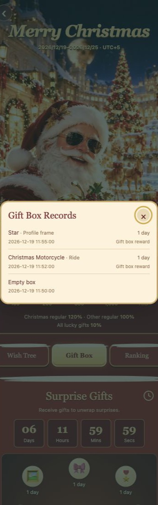
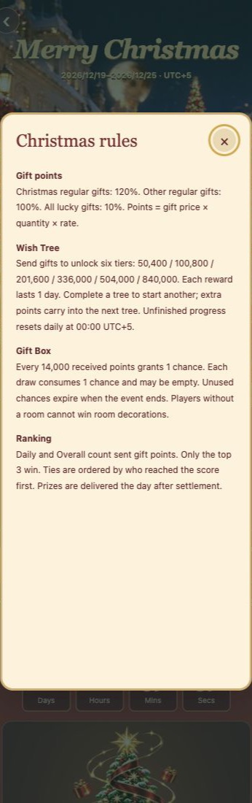

# 圣诞心愿季｜页面截图与PRD说明

参考CP活动墨刀的“页面截图＋对应业务说明”方式整理。日期：2026-11-18。截图基于圣诞活动已确认Demo，正式资源和业务规则以PRD为准。

截图为便于审阅展开的页面／弹窗长图，实际页面继续使用内部滚动；不表示实际设备同时显示全部内容。奖励图标仍为演示占位，记录和分数均为模拟数据。

参考：[CP活动墨刀](https://modao.cc/proto/bh9nPIILtk3vt3Bs7Ak2IF/sharing?view_mode=read_only&screen=rbpVaaOOP0X6SlepW)。

## 活动配置与共用礼物

Yaloka圣诞活动，包含Wish Tree、Gift Box、Ranking三个Tab。送礼点亮圣诞树，收礼兑换拆盒机会，送礼参与日榜、总榜。

| 项目 | 配置 |
| --- | --- |
| 活动时间 | 2026年12月19日00:00:00—12月25日23:59:59 |
| 业务时区 | UTC+5 |
| 参与对象 | 全部用户 |
| 礼物往来对象 | 不限 |

### 1.1 活动礼物与活动值

| 类型 | 礼物 | 价格（金币） | 计入比例 |
| --- | --- | ---: | ---: |
| 圣诞幸运礼物 | 墨镜 | 100 | 10% |
| 圣诞幸运礼物 | 圣诞帽 | 200 | 10% |
| 圣诞幸运礼物 | 金苹果 | 500 | 10% |
| 圣诞幸运礼物 | 车钥匙 | 1,000 | 10% |
| 圣诞普通礼物 | 名称、款数待补 | 5,000–15,000，具体售价待补 | 120% |
| 其他幸运礼物 | 平台现有礼物 | 原价 | 10% |
| 其他普通礼物 | 平台现有礼物 | 原价 | 100% |

活动值＝礼物单价×数量×对应比例。不同礼物折算后合并累计；指定比例优先，每笔在同一规则内只计算一次。幸运中奖返还不增加活动值。精度及整数展示沿用活动模版统一规则。

同一笔礼物分别推动送礼方的圣诞树、送礼日榜、送礼总榜，以及收礼方的礼盒进度。各规则独立累计，圣诞树重置和礼盒抽奖不扣减榜单积分。

活动礼物专区及计入说明由三个Tab共用。奖励叠加引用[活动奖励通用规则](https://github.com/hhahahani-lab/product-tutorials/blob/main/rules/activity-reward-common.md)。

### 1.2 个人装扮资源

| 用途 | 主题 | 资源数量 |
| --- | --- | --- |
| Ranking Top奖励 | 圣诞老人款 | 头像框1款、徽章1款、飘带1款、名片框1款、国王款座驾1款 |
| Wish Tree、Gift Box | 星星款、雪人款 | 头像框、徽章、飘带、名片框各2款（每个主题各1款），摩托款座驾共1款 |

本期暂不配置发言气泡。普通座驾统一为摩托座驾，高级座驾统一为国王座驾；国王座驾仅投放Ranking，Wish Tree和Gift Box的座驾奖励均使用摩托座驾。Wish Tree投放雪人款，Gift Box投放星星款，Ranking投放圣诞老人款。

## 1. 圣诞树 Wish Tree

### 圣诞树主页面

### 2.1 送礼达档

按个人送出礼物累计活动值，使用F：单日统计、各档叠加，开启单日循环。

| 档位 | 本轮累计活动值 | 本档奖励，均为1天 |
| --- | ---: | --- |
| 1 | 50,400 | 雪人头像框 |
| 2 | 100,800 | 雪人徽章 |
| 3 | 201,600 | VIP1 |
| 4 | 336,000 | 雪人进场飘带＋VIP2 |
| 5 | 504,000 | 雪人进场飘带＋摩托座驾＋VIP3 |
| 6 | 840,000 | 摩托座驾＋雪人名片框＋VIP4 |

- 门槛为本轮累计值，达到档位自动发放该档全部奖励，每档每轮仅发一次。
- 完成最高档后扣除840,000活动值，余值进入下一轮，可以重复获奖；单笔跨过多档或多轮时发放所有新达成奖励。同日不设额外轮数上限。
- 每日00:00重置轮次和本轮进度，未完成部分不结转；已发奖励保留。活动结束后停止累计，未达档不补发，已达档奖励正常发放。

### 2.2 页面与记录

默认展示下一待达档位；可左右切换回看已达档或查看后续档位。切换只改变查看内容，不扣活动值、不触发发奖；最高档完成后展示新一轮对应进度。

展示本轮当前活动值、所选档位门槛、奖励及达成状态。倒计时对应当日截止时间，最晚在活动结束时截止。

送礼入口打开客户端送礼能力；Demo中的礼物选择及送礼反馈为模拟交互。

记录入口打开本玩法获奖记录，展示奖励具体名称、类型、天数、获得时间及档位；重复获奖保留对应次数，不因跨日或进度重置删除历史记录。

## 2. 惊喜礼盒 Gift Box

### 礼盒主页面

### 3.1 收礼兑换与拆盒

使用E，任务组合选择收礼，按个人活动期累计。每14,000活动值自动获得1次拆盒机会，未满一次的余值继续累计，不每日清零。

- 展示可用次数，以及“本周期未兑换余值／14,000 → +1 chance”；余值不包含已兑换成次数的活动值。
- 提供“开1次”和“一键全开”两个操作。开1次消耗1次机会；一键全开消耗点击时全部可用次数，每次独立按相同奖池权重抽取一项；操作期间新增次数不计入本次全开。抽中奖励后发放；抽中空奖也消耗机会，展示未中奖结果，不发送奖励到账消息。
- 全开完成后统一展示结果，同一奖励合并展示获得次数及每次时长；空奖展示次数。记录仍逐次保存每次抽奖结果。操作处理中两个按钮不可重复触发。
- 可用次数为0时，两个按钮均不可用；仅剩1次时，一键全开等同开1次。活动结束后停止累计、兑换及抽奖，未使用次数和剩余余值失效。
- 倒计时对应活动结束时间。记录入口查看本玩法抽奖记录，中奖记录展示具体奖励名称、类型、天数和完整时间；空奖记录只展示一次空奖结果及时间。

### 3.2 奖池

| 奖项 | 每次奖励时长 | 概率 | 权重 |
| --- | --- | ---: | ---: |
| 空奖 | — | 10% | 100 |
| 星星头像框 | 1天 | 17% | 170 |
| 星星进场飘带 | 1天 | 12% | 120 |
| 星星徽章 | 1天 | 15% | 150 |
| 星星名片框 | 1天 | 12% | 120 |
| 摩托座驾 | 1天 | 6% | 60 |
| 房间封面 | 1天 | 9% | 90 |
| 房间背景 | 1天 | 7% | 70 |
| 房间标签 | 1天 | 8% | 80 |
| VIP1 | 1天 | 2% | 20 |
| VIP2 | 1天 | 1.5% | 15 |
| VIP3 | 1天 | 0.5% | 5 |
| 合计 | | 100% | 1,000 |

抽奖时按是否已创建房间选择奖池：有房间使用上表，房间装扮发至对应房间；无房间将三项房间装扮共240权重转入空奖，空奖权重340（空奖概率34%），其他奖项不变，总权重仍为1,000。后续创建房间后，新的抽奖使用有房间奖池。

上述概率用于后台配置，活动页面及Rule不展示概率；玩法说明不增加空奖提示，实际抽奖结果如实反馈。

## 3. 送礼榜 Ranking

### 日榜主页面

### 总榜主页面

### 日榜奖励弹窗

### 总榜奖励弹窗

### 4.1 送礼榜单

仅设个人送礼榜，使用两条D规则，统计指标为金币价值，按第一节比例折算计分。

| 周期 | 统计范围 |
| --- | --- |
| Daily | 当日符合条件的送礼活动值，每日00:00重新累计，最晚在活动结束时截止 |
| Overall | 活动期内符合条件的送礼活动值，持续累计至活动结束 |

两榜仅Top3获奖。上榜范围、Top3／列表／My展示、数值格式、同分排序、在房跳转及结榜次日发奖引用[活动榜单通用规则](https://github.com/hhahahani-lab/product-tutorials/blob/main/rules/activity-ranking-common.md)。

切换周期同步更新榜单、My数据和四格倒计时。奖励入口打开当前榜单周期的奖励，可在弹窗内切换Daily／Overall查看；弹窗内切换不改变外部榜单。

### 4.2 日榜奖励

| 名次 | 奖励 |
| --- | --- |
| Top1 | 圣诞老人头像框＋圣诞老人徽章＋国王座驾，各3天 |
| Top2 | 圣诞老人头像框＋圣诞老人徽章＋国王座驾，各2天 |
| Top3 | 圣诞老人头像框＋圣诞老人徽章＋国王座驾，各1天 |

### 4.3 总榜奖励

| 名次 | 装扮及VIP | 额外奖励 |
| --- | --- | --- |
| Top1 | 圣诞老人头像框、圣诞老人徽章、国王座驾、圣诞老人名片框、VIP7，各30天 | banner展示7天＋开屏展示7天＋冠军档靓号30天 |
| Top2 | 圣诞老人头像框、圣诞老人徽章、国王座驾、圣诞老人名片框、VIP6，各15天 | 亚军档靓号30天 |
| Top3 | 圣诞老人头像框、圣诞老人徽章、国王座驾、圣诞老人名片框、VIP5，各10天 | 季军档靓号30天 |

装扮及VIP沿用榜单自动发奖；banner、开屏及靓号按最终资源及兑现配置执行，不将Demo占位展示视为已支持自动发放。

## 4. 奖励记录

### 圣诞树获奖记录

### 礼盒抽奖记录

| 页面 | 展示与规则 |
| --- | --- |
| Wish Tree Records | 展示本玩法已获得的奖励、对应档位和获得时间；重复获奖保留对应次数；跨日或轮次重置不删除历史记录。 |
| Gift Box Records | 展示本玩法每次抽奖结果和时间；中奖记录包含奖励名称、类型、天数；空奖只保留一次结果及时间。 |

- 奖励记录使用文字，展示具体名称、类型、天数，时间为`YYYY-MM-DD HH:mm:ss`。
- 无记录时展示空状态。记录按活动时区UTC+5显示，不单独添加时区标签。
- 截图中的昵称、活动值、抽奖结果和记录时间均为演示数据。

## 5. 活动规则 Rule

### 活动规则弹窗

- 点击活动Rule入口查看英文活动规则。
- 说明礼物活动值计入比例、圣诞树累计及重置、收礼兑换拆盒次数和有效期、送礼榜周期及发奖规则。
- Rule不展示奖池概率；概率仅用于后台配置。
- 关闭后返回原玩法，保留当前查看状态。

正式业务说明以本说明中的配置和各玩法规则为准。

## 待补资源

- 圣诞普通礼物名称、款数及具体售价，正式奖励资源ID。
- 圣诞老人进场飘带已列入素材清单，当前奖励配置尚未投放；是否加入总榜套装待确认。
- Banner、开屏投放位置、排期及靓号兑现配置，沿用完整PRD待补项。
